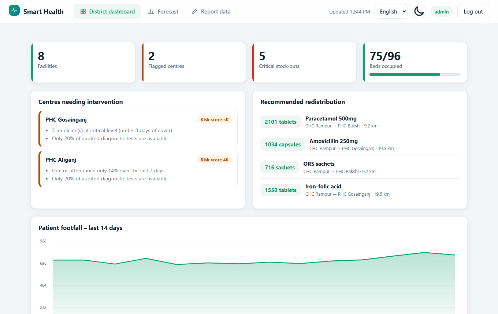
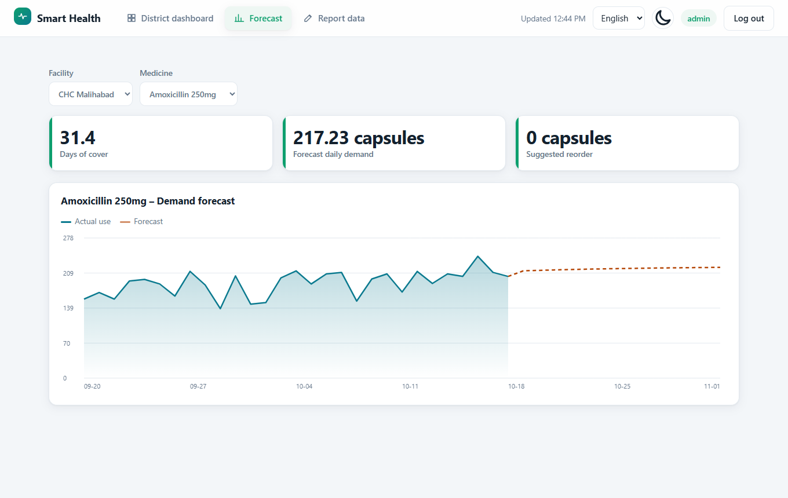
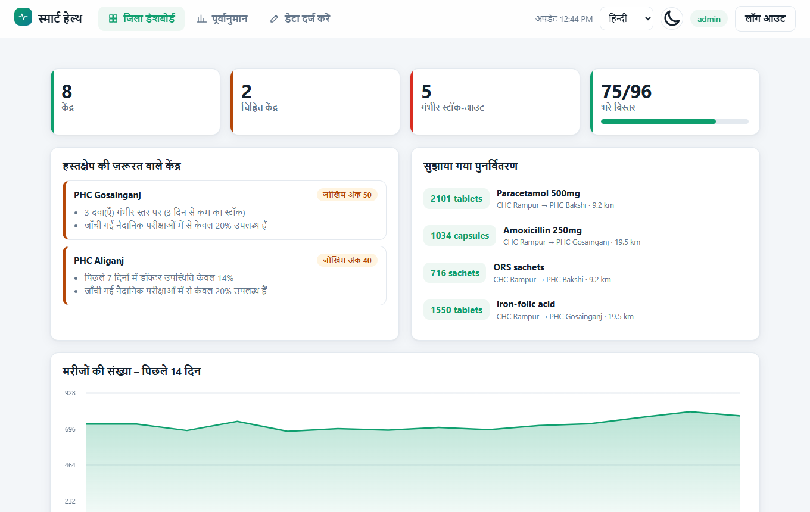
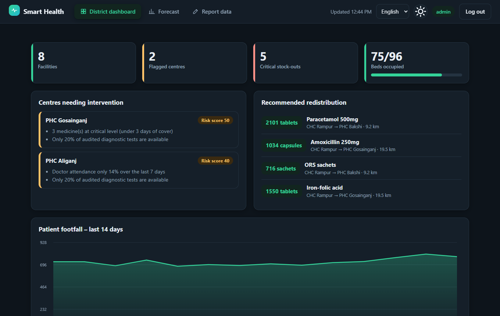

# Smart Health – AI-driven Health Centre & Supply Chain Management

[](https://github.com/nehabhosle19/smartHealth/actions/workflows/ci.yml)

> PHCs and CHCs run out of medicine, fill up on beds and lose doctors to absence — and nobody
> notices until patients are turned away. **Smart Health** gives a district administrator one live
> view of every centre, warns *before* stock runs out, recommends where to move supplies from, and
> flags the centres that need intervention. Multilingual: English, हिन्दी, தமிழ்.

## 🔗 Live demo
**[https://smarthealth-xbcw.onrender.com](https://smarthealth-xbcw.onrender.com/)** *(free hosting – the first load can take ~30-60 s while it wakes up)*

| Role | Username | Password |
|---|---|---|
| District administrator | `admin` | `Hack#Prompt@23$` |
| Centre staff (PHC Aliganj…) | `staff1` … `staff8` | `Hack#Prompt@23$` |

Demo data is fictional. Try: dashboard → flagged centres → stock-out warnings → redistribution →
switch language (top right) → log in as `staff1` and report today's stock.

## Screenshots
| District dashboard | Demand forecast |
|---|---|
|  |  |
| **Hindi UI** | **Dark mode** |
|  |  |

## Problem → solution
| Requirement | How Smart Health delivers it |
|---|---|
| Stock monitoring | Daily closing stock and consumption per medicine per centre |
| Patient footfall | Daily counts, 14-day trend chart, surge detection |
| Bed availability | Occupancy per centre and district-wide; ≥ 85 % raises a flag reason |
| Doctor attendance | 7-day attendance rate per centre |
| Test availability audits | Per-test audit; missing tests shown on every centre row |
| Early stock-out warnings | Days-of-cover from forecast demand: critical < 3 d, warning < 7 d, plus suggested reorder |
| AI demand forecasts | Holt damped-trend exponential smoothing → 14-day forecast chart |
| Smart redistribution | Greedy match of urgent shortages to the nearest centres with surplus; donors keep 21 days |
| Auto-flag weak centres | Explainable 0-100 risk score with reasons; live banner on new high-severity centres |
| Multilingual | UI and server-generated alerts in English, Hindi, Tamil |

## Evaluation criteria
| Criterion | What we did |
|---|---|
| **Code quality** | Pure, typed analytics module separated from I/O; Pydantic validation; ruff-clean; Alembic migrations; documented config |
| **Security** | PBKDF2 passwords, HttpOnly SameSite cookies + CSRF header, role & per-facility authorisation, login throttling, strict input bounds, CSP/HSTS, audit log, fail-fast production config, dependency audit in CI – see [SECURITY.md](SECURITY.md) |
| **Efficiency** | ~6 bulk queries per dashboard (no N+1), indexed columns, O(n) forecasting, no frontend build step or heavy libraries |
| **Testing** | 110 automated tests at **98 % backend coverage** (CI fails below 90 %): analytics invariants, security primitives, API RBAC/validation/i18n, CLI, config, race conditions, translation parity, plus real-browser journeys (Playwright) and frontend unit tests; CI runs on SQLite *and* PostgreSQL |
| **Accessibility** | Automated **axe-core WCAG 2.1 A/AA scan in CI** (login, dashboard, forecast, forms; light *and* dark) with zero violations; contrast-safe colour tokens; skip link, landmarks, one `<h1>` per view, `aria-current` navigation, focus moved to content on navigation, alert vs status live regions, every chart also available as a data table, `lang` set per language, reduced-motion and forced-colors support |

## Tech stack
Python 3.12 · FastAPI · SQLAlchemy 2 · PostgreSQL / SQLite · Alembic · vanilla JS + Canvas (no build step) · Docker · GitHub Actions

## Features
- **Stock monitoring & early warnings** – cover = stock ÷ forecast demand; *critical* < 3 days, *warning* < 7-day lead time, with a suggested reorder quantity.
- **Demand forecasts** – Holt damped-trend exponential smoothing over 28 days of consumption → 14-day forecast chart.
- **Redistribution** – per medicine, most-urgent shortages are matched to the *nearest* centres with surplus (> 30 days' cover); donors always keep 21 days.
- **Automatic flagging** – explainable 0-100 risk score (stock 35, attendance 25, beds 20, tests 15, footfall surge 10, stale data 10). ≥ 40 is flagged, ≥ 65 high severity. A banner appears when a centre newly becomes high severity.
- **Live dashboard** – auto-refreshes every 30 s; footfall trend, bed occupancy, attendance, missing tests per centre.
- **Roles** – district *admin* sees everything; centre *staff* see and report only their own centre.

## Quick start (development, 2 minutes)
```bash
pip install -r requirements-dev.txt
python -m playwright install chromium          # once, for the browser/accessibility tests
python -m smarthealth.manage seed-demo          # fake data; prints demo logins once
python -m uvicorn smarthealth.app:create_app --factory
# open http://127.0.0.1:8000  -> admin / staff1 … staff8
python -m pytest                                 # 102 tests (unit, API, browser + accessibility)
node --test tests/js/frontend.test.mjs           # 8 frontend tests
```
Set `SMARTHEALTH_DEMO_PASSWORD` before `seed-demo` to choose the demo password.
Hosting a demo without shell access? Set `SMARTHEALTH_DEMO_PASSWORD` on the host — see [DEPLOYMENT.md](DEPLOYMENT.md#demo--hackathon-hosting-without-a-shell-eg-free-render).

## Production
See **[DEPLOYMENT.md](DEPLOYMENT.md)** (Docker + PostgreSQL, Render/Railway/VPS) and **[SECURITY.md](SECURITY.md)**.
In short:
```bash
cp .env.example .env        # fill in SMARTHEALTH_SECRET, passwords, your hostname
docker compose up -d --build
docker compose exec app python -m smarthealth.manage create-admin --username district.admin
```
There are **no default accounts**. Production mode refuses to start without a strong secret and
`Secure` cookies, and refuses to load demo data.

## Project layout
```
smarthealth/
  analytics.py     pure forecasting / redistribution / scoring (no I/O, fully unit-tested)
  service.py       bulk-loads data (few queries, no N+1) and feeds analytics
  presenters.py    turns computed state into translated JSON responses
  deps.py          FastAPI dependencies: DB session, authentication, authorisation
  routers/         thin HTTP layer: auth, reports (data entry), district, facilities, health
  middleware.py    body-size limit, Host check, security headers
  app.py           application factory that wires everything together
  manage.py        admin CLI (create admin/staff, facilities, medicines, passwords)
migrations/        Alembic migrations (run automatically by the Docker entrypoint)
static/            dependency-free frontend as ES modules (js/state, dom, api, components, charts, views)
tests/             102 Python tests (incl. tests/e2e browser + axe accessibility) and tests/js frontend tests
```
See [docs/ARCHITECTURE.md](docs/ARCHITECTURE.md) for the request flow and design decisions.

## Configuration
All via environment variables — see [.env.example](.env.example). Analytics thresholds live in
[smarthealth/config.py](smarthealth/config.py).

## Adding a language
Add a block to `MESSAGES` in `smarthealth/i18n.py` (alerts) and to `static/i18n.js` (UI), then add the
language to `LANGS` in `static/app.js`. Have a native speaker review translations before go-live.

## Limitations
- The forecaster is statistical (no ML training data required) and works best with ≥ 14 days of history.
- Data entry is per-record through the UI; there is no CSV bulk import or e-mail/SMS alerting yet.
- Login throttling is per process – add proxy-level rate limiting when running several instances.
